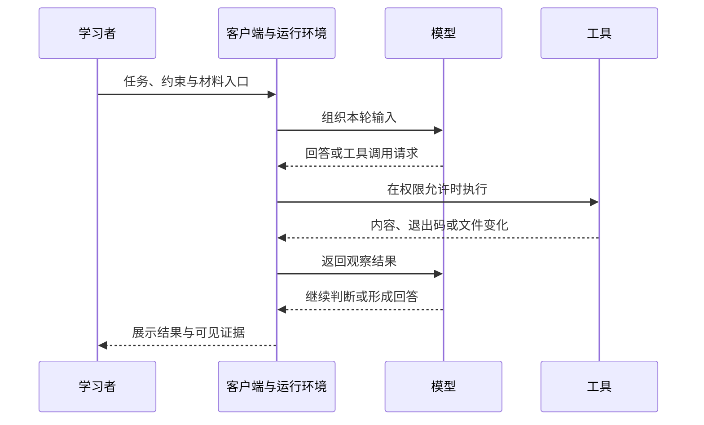

# Foundations：先看懂一次 AI Coding 任务

> 阅读位置：按需基础导读。需要区分角色、信息与证据时阅读；[任务定义与验收](../02-coding-workflows/task-context-acceptance.md)和配套实践可按当前问题选用，不要求先完成本节练习才能进入工程项目。
>
> 本节目标：能解释“谁生成、谁执行、依据从哪里来、结果怎样确认”。不要求实现 Agent、配置 API，或先学完整机器学习课程。

## 1. AI Coding 在做什么

AI Coding 是让 AI 参与代码理解、方案讨论、修改、测试和审查的开发方式。一次任务可以只读解释，也可以在允许范围内修改文件、执行命令并检查结果。

需要先区分两类事情：**生成描述**与**改变实际状态**。输出一段代码，文件不一定已经保存；写出测试命令，命令不一定已经执行；说“测试通过”，还需要实际运行证据。

本导读先建立可靠使用能力：给出任务和必要依据，核对实际变化，解释关键代码，并处理小变化或故障。后续三条主线分别回答：

| 主线 | 主要问题 |
| --- | --- |
| Coding Workflows | 如何组织从读代码、修改到交付的一次任务？ |
| Context Engineering | 应提供哪些资料，怎样处理遗漏、冲突与旧信息？ |
| Reliability and Evaluation | 怎样检查结果、发现失败，并避免把偶然成功当成稳定能力？ |

基础知识服务这些问题。这里先搭起关系，不按术语数量衡量掌握程度。

## 2. 模型、客户端、工具与 Agent

以下是本导读采用的工作定义，用于描述可观察的系统，不据此推断某个产品的内部实现。

| 名称 | 职责 | 可以观察什么 |
| --- | --- | --- |
| 模型 | 根据收到的信息生成回答或操作建议 | 回答、代码建议、工具调用请求等可见输出 |
| 客户端 | 提供交互入口并组织模型与工具的使用 | 当前任务、选中的文件、可见设置和操作记录 |
| 工具 | 执行读文件、编译、运行测试等具体操作 | 参数、退出码、标准输出和实际文件变化 |
| Agent | 围绕目标反复选择操作、观察结果并继续工作的系统 | 可见的操作序列与最终产物 |

例如，模型可以提出“读取某个源文件”，客户端或运行环境负责安排相应工具执行，工具返回内容，再成为后续判断的依据。文件读取是否被允许，还取决于实际权限与任务范围。



图示是理解交互关系的简化模型，不保证每次任务都调用工具，也不保证所有内部输入都能在界面看到。遇到不可见部分应标记未知。

“使用 Agent”和“自己实现 Agent”是不同学习目标。当前只需要理解上述关系；Building Agents、Mini Agent 和复杂实现仍在 Backlog。

## 3. 模型怎样使用信息：先掌握够用的认识

语言模型经过训练，形成处理语言和代码的能力；日常使用时，把当前输入交给模型产生输出，这个使用过程称为推理（inference）。日常对话里补一句要求，不等于当场重新训练模型或永久改写其参数。

文本生成模型根据输入及已生成内容继续生成输出。它能够生成解释、代码和判断，但这套生成过程本身不等于调用编译器，也不是事实核验程序。由此得到本导读的一条使用原则：**语言上合理，只是需要检查的候选结果。**

可以把提示（prompt）理解成提供给模型的任务输入。明确目标与约束有助于减少猜测，但没有某句话能代替源代码、测试和实际运行结果。[OpenAI 关键概念](https://developers.openai.com/api/docs/concepts)介绍了文本模型、提示与 Token 的基本关系；实现细节暂不作为前置。

## 4. Token 与上下文窗口

**Token** 是模型处理文本的分词单位，可能对应字符、词的一部分或其他字符片段。它不等于 C++ Token，也不固定等于一个汉字或一个英文单词；具体切分依赖所用编码。

**上下文（context）** 是本轮模型可用的信息，例如任务要求、部分对话、读取到的文件和工具结果。**上下文窗口**是单次请求可处理的 Token 容量限制；输入与生成也要共享相关容量，具体计数与模型限制按实际文档核对。[Token 定义](https://developers.openai.com/api/docs/concepts)、[上下文窗口说明](https://developers.openai.com/api/docs/guides/conversation-state#managing-the-context-window)

本节不需要记容量数字。先理解三个区别：

| 容易混淆的情况 | 需要区分 |
| --- | --- |
| 文件在磁盘上 | 文件存在，不等于工具已读，也不等于全文进入本轮模型输入 |
| 聊天窗口里仍能看到旧消息 | 界面历史不等于每次都逐字发送完整历史 |
| 上下文容量很大 | 能容纳更多内容，不保证每条材料正确、相关或被恰当使用 |

这解释了为什么后续要学习上下文选择：任务失败可能来自缺少接口约定，也可能来自混入过期说明。先检查提供了什么、实际读取了什么，再讨论模型能力。

## 5. 上下文、项目笔记与长期记忆

这里先区分信息的存放位置，不假定任何客户端自动记住全部内容：

- **本轮上下文**：当前请求实际可用的信息。
- **项目文件**：磁盘上的代码、说明与笔记；需要通过相应机制进入任务信息。
- **持久记忆**：系统在不同任务之间保存、检索和再次提供的信息；是否存在、如何启用和读取，取决于具体产品或实现。

保存笔记的价值，是能在需要时恢复依据；保存本身不保证下一次请求已包含它。压缩或总结也可能遗漏细节，重要接口与验收要求应回到原始材料核对。

当前先会查阅项目说明和定位相关文件即可，不需要搭建检索系统、向量数据库或自动记忆系统。

## 6. 工具执行、权限与 API

工具让系统能观察或改变实际环境。例如，读文件取得文本，编译器检查能否生成程序，测试程序检查某些行为。工具可能失败，返回结果也有适用范围：一个用例通过，不等于全部功能正确。

权限决定某个操作是否被环境允许，任务范围决定这次工作应该操作什么。工具能访问一个目录，不代表本次任务允许修改整个目录；反过来，任务要求执行某操作，也可能因环境权限不足而无法执行。

**API** 是程序调用服务或功能的接口。直接写程序调用模型 API，与通过已有客户端使用模型，是不同接入方式。学会当前协作任务不要求先写 API 客户端；当前订阅是否包含 API 权限或费用，也不能凭使用客户端推断。

Skills、MCP 等扩展机制，等实际任务需要时再学。这些名词目前只需知道属于能力组织或工具连接层，不作为本单元验收内容。

## 7. 为什么要有外部证据

常见问题包括：补全不存在的接口、漏掉约束、参考旧版本、把建议命令说成已执行，以及从少数成功例子过度推广。这些问题不能只靠让 AI 再说一遍“确定正确吗”排除。

一个简单例子：

- 回答中出现 `g++ main.cpp`：只能说明给出了命令文本。
- 工具记录出现这条命令并成功返回：支持这次编译完成，还需核对文件和版本。
- 程序运行并通过明确断言：支持这些用例下的行为，未覆盖输入仍是局限。
- 学习者能解释逻辑并处理变式：才增加个人理解与迁移的证据。

这几层证据逐步增加，彼此不能自动替代。下一单元再学习怎样把任务、上下文和验收组合成一次修改。

## 8. 第一个只读练习

这次只观察一次读取过程，不修复代码、不运行端口实验。先在本地计划写下自己对下面问题的判断，未知项标记未知：

1. 发出任务后，哪些部分由模型生成，哪些需要工具执行？
2. 仅凭“我已读过”这句话，能否确认读取了当前文件？还想看到什么依据？
3. 当前界面能确认客户端或模型的哪些信息，哪些信息不可见？

随后在实际学习环境中发出一个只读任务，例如：

```text
只读取 ai-coding-notes 根目录的 README.md，不修改文件、不运行项目代码。
请给出文件第一行原文，并区分实际读取到的内容与无法确认的信息。
```

把目标文件所在仓库作为任务环境，或明确给出实际绝对路径；不要求先新建对话或迁移仓库。观察可见操作记录，并自己打开文件对照。如果没有文件读取能力，就记录阻塞，不把猜中的第一行当作读取证据。

完成后，用自己的话解释这一次交互里发生了什么、哪些结论有依据、哪些仍未知。个人判断、实际过程和掌握状态记录在本地计划，不预填到公开教材。

## 9. 理解检查与后续阅读

- 能用自己的话区分模型、客户端、工具与 Agent。
- 能解释文件存在、工具读取与本轮上下文之间的区别。
- 知道 Token 和窗口是在限制什么，不要求背数字。
- 能区分命令建议、实际执行、结果正确与个人理解。
- 完成一次只读观察，或准确说明阻塞与待验证项。

这些问题用于定位当前缺口，不构成进入工程项目的门槛。已有任务提供相应理解和证据时无需重复练习；缺少哪部分，就补哪部分。需要组织一次修改时可阅读[从任务定义到验收](../02-coding-workflows/task-context-acceptance.md)。可以查阅本节，不要求长期背诵全部术语；Transformer 推导、模型训练和 Agent 实现继续按需后置。
